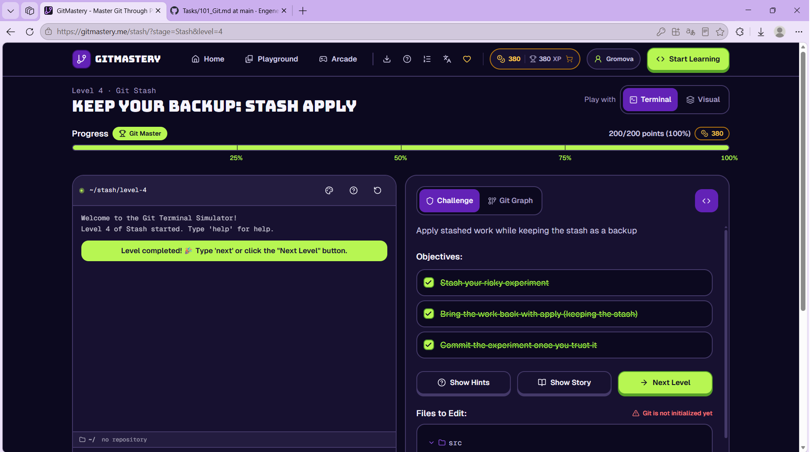

# Отчет по лабораторной работе №1
## Основы Git и совместной разработки на GitHub

Выполнил(а): __Громова Эльвира__  
Группа: __РИЗМ-161207__

### Список пройденных тем:
**Уровень Beginner:**
- Введение в Git
- Операции с файлами
- Работа с ветками
- Удалённые репозитории

**Уровень Advanced:**
- Слияние веток
- Рабочие процессы Git
- Командная работа
- Отмена коммитов
- Временное хранилище

Так как я уже была знакома с Git, базовый уровень оказался скорее повторением, я освежила в памяти файлы, коммиты и ветки. А вот продвинутый уровень оказался полезнее: разобралась еще лучше с командными процессами, конфликтами и отменой коммитов. Ещё закрепила stash, которым раньше почти не пользовалась.

