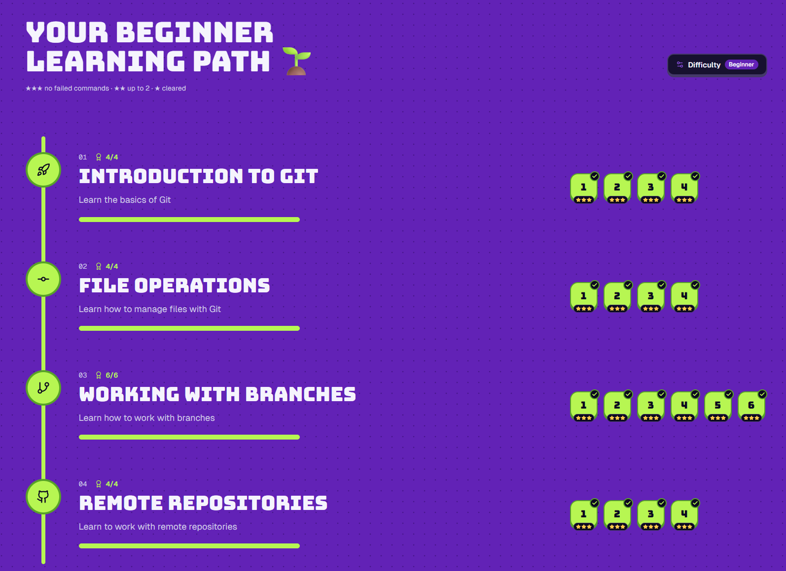
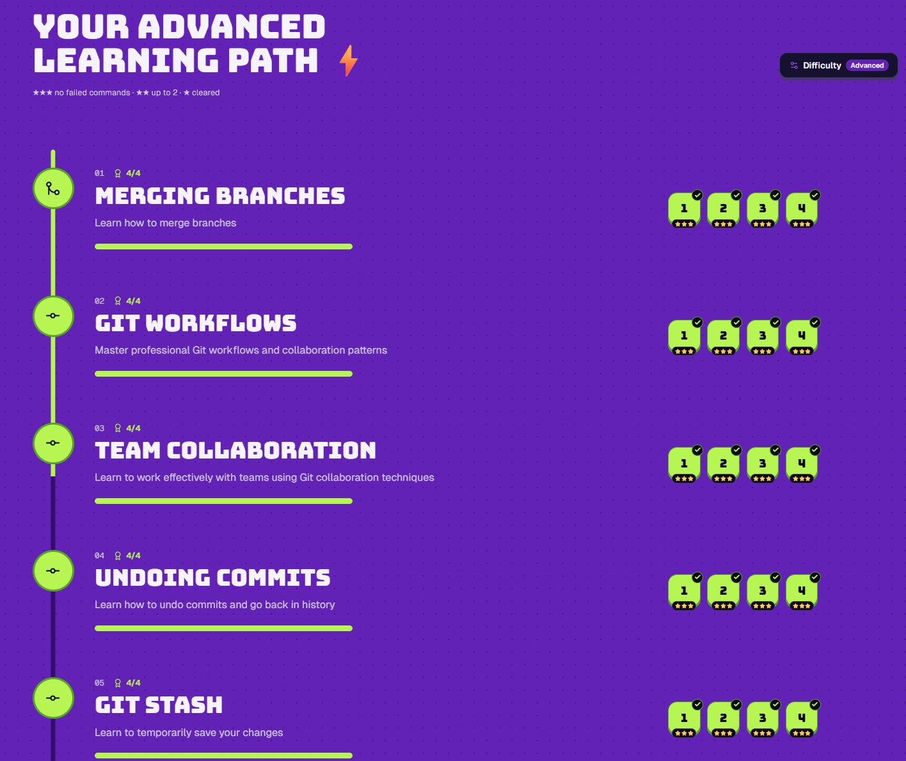
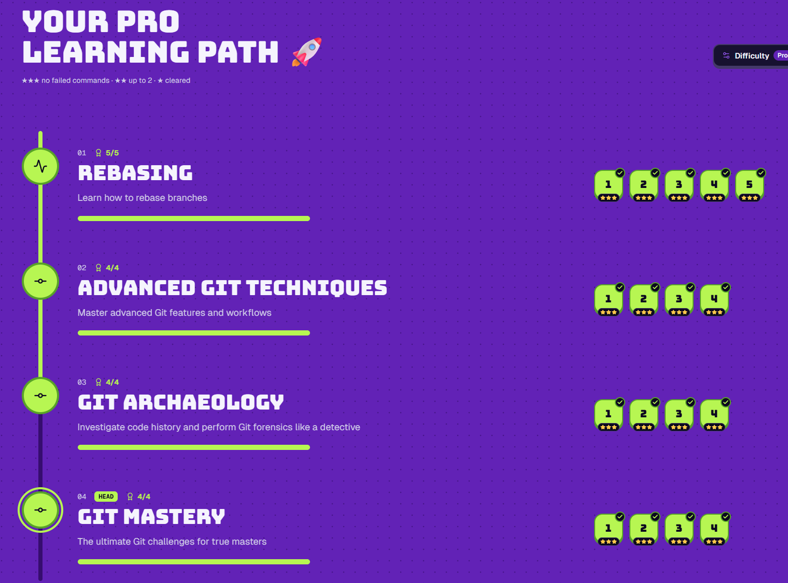

# Лабораторная работа 101. Основы Git и совместной разработки на GitHub

Студент: Линберг Денис Алексеевич, РИЗМ-161207

## Пройденные уроки Git Mastery

Все три уровня сложности пройдены полностью.

### Beginner
- Introduction to Git
- File Operations
- Working with Branches
- Remote Repositories

### Advanced
- Merging Branches
- Git Workflows
- Team Collaboration
- Undoing Commits
- Git Stash

### Pro
- Rebasing
- Advanced Git Techniques
- Git Archaeology
- Git Mastery

## Итоги

С Git я работаю давно, поэтому ничего нового не узнал, лишь освежил память о командах, которыми редко пользуюсь: отмену слияния (`merge --abort`), ручное разрешение конфликтов, отмену коммитов через `reset` и `revert`, `stash`. Fork-workflow (форк, отдельная ветка, push в форк).
